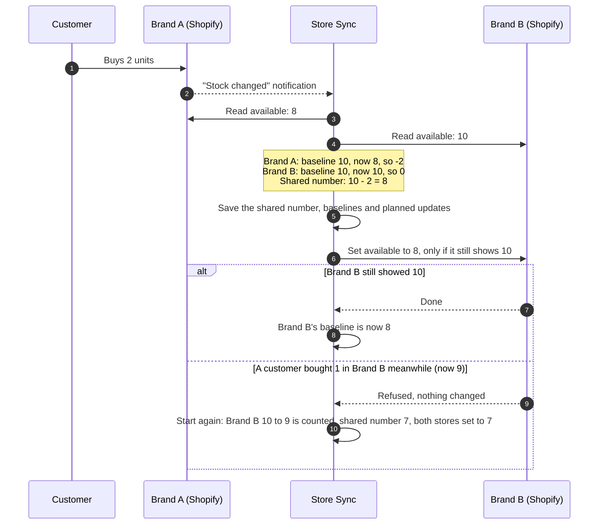

# How sync works

This page explains what Store Sync does with your stock, and why you can trust the numbers. The
first part is for anyone. The last part, [Under the hood](#under-the-hood), is for developers.

## The shared number

For every product, Store Sync keeps **one shared number**: how many units you can still sell,
across all your stores together. Every store shows that number, minus its
[safety buffer](#safety-buffers) if it has one.

Store Sync syncs Shopify's **available** quantity: units you can sell right now. It doesn't sync
"on hand" (which includes units already sold but not shipped yet) or "incoming" stock.

If you have [several warehouses](#several-warehouses), there is one shared number per product per
warehouse.

## What happens when something changes

Shopify tells Store Sync whenever a stock number changes in any store. Store Sync then:

1. **Reads the current number in every store.** The notification is only a nudge. Store Sync always
   reads the real numbers itself, so late, repeated or out-of-order notifications do no harm.
2. **Works out what changed in each store.** For each store, Store Sync remembers the last number it
   knows that store had. We call it the store's **baseline**. If Brand A had 10 and now has 8, then
   2 units left Brand A. A sale, a refund or a staff edit all show up this way.
3. **Updates the shared number.** All changes from all stores are added up: if Brand A sold 2 and
   Brand B sold 1, the shared number drops by 3.
4. **Updates every store that shows something else.** Each update only goes through if the store
   still shows what Store Sync just read. If a customer bought something in that store a moment
   ago, Shopify refuses the update, and Store Sync starts again from step 1. That's how a sale is
   never overwritten.
5. **Remembers the new numbers** as the stores' baselines.

Store Sync's own updates never count as sales or restocks: when an update is confirmed, the baseline
moves with it. That is why stock never "bounces" between stores or gets counted twice.

## Everyday situations

| Situation                                   | What Shopify does to "available"                     | What Store Sync does                                                       |
| ------------------------------------------- | ---------------------------------------------------- | -------------------------------------------------------------------------- |
| Online order                                | Goes down as soon as the order is placed.            | Every store goes down.                                                     |
| Order shipped (fulfilled)                   | No change: the units were already taken off.         | Nothing.                                                                   |
| Order cancelled, items restocked            | Goes back up.                                        | Every store goes back up.                                                  |
| Order cancelled without restocking          | No change.                                           | Nothing.                                                                   |
| Refund or return, items restocked           | Goes up at the location you restock to.              | Every store goes up, if that location is the one holding the shared stock. |
| Refund without restocking                   | No change.                                           | Nothing.                                                                   |
| Exchange                                    | Returned item up (if restocked), new item down.      | Each product is synced on its own.                                         |
| Order edited (items added or removed)       | Down for added items, up for restocked removed ones. | Every store follows.                                                       |
| Draft order that reserves stock             | Goes down while reserved, back up if it expires.     | Every store follows.                                                       |
| POS sale or POS return                      | Changes at the POS location.                         | Synced only if the POS location is the one holding the shared stock.       |
| Staff changes a number in the Shopify admin | Changes.                                             | Counted as a real change. See [staff edits](#staff-edits-and-csv-imports). |
| Inventory CSV import                        | Every row changes.                                   | Every change is counted. See [CSV imports](#staff-edits-and-csv-imports).  |
| Another app changes stock (bundles, ERP...) | Changes.                                             | Counted like any other change.                                             |
| Units moved to "damaged" or "safety stock"  | Goes down.                                           | Every store goes down: those units can't be sold anywhere.                 |
| Incoming transfer or purchase order         | No change until received.                            | Synced when the units are received.                                        |

Pre-orders and subscriptions that only take stock when they ship reduce "available" late. Store
Sync follows "available", so it only sees them when Shopify takes the stock.

### Staff edits and CSV imports

Any change typed into a store counts as real. That's what you want for sales and corrections, but
watch out for three things:

- **Enter a delivery once, not in every store.** If you add 24 units in Brand A and again in Brand
  B, Store Sync counts 48. When the same quantity is added in two stores within 10 minutes, Store
  Sync warns you with an alert, so you can undo the extra units. The best place to enter deliveries
  is the product's page in Store Sync (**Add/remove units**).
- **Don't type a shelf count into a store with a safety buffer.** If Brand B has a buffer of 5, it
  shows 15 when you have 20. Typing 20 into Brand B adds 5 units that don't exist. Use **Set stock
  to…** in Store Sync instead.
- **Don't import an old inventory CSV.** Importing a file exported last week would undo every sale
  since then, in all stores. If many products drop to zero at once, the
  [circuit breaker](#the-circuit-breaker) pauses sync before the damage spreads.

### Counting the shelf

Units that are sold but not shipped yet are still on your shelf, but they aren't available. So if
you count 40 on the shelf and 3 are waiting to ship, the right shared number is 37. The admin API
also accepts a **stock count**: you give it the shelf count, and Store Sync subtracts every store's
unshipped orders for you.

## Safety buffers

Two customers in two stores can buy the last unit within the same few seconds, before any store
hears about the other sale. A **safety buffer** makes a store show fewer units than you have, so the
last units are kept back: with a shared number of 10 and a buffer of 2, the store shows 8. When the
shared number is 2 or less, it shows 0.

Sales in a store with a buffer still reduce the shared number by the real amount sold.

## Oversold products

If two stores sell the last unit at the same time, the shared number goes below zero. Store Sync
then shows 0 in every store and raises an **oversold** alert, so you can cancel or delay one order.
It never sends a negative number to a store.

If a product is set to **Continue selling when out of stock** and a store already shows less than
zero, Store Sync leaves it there. Raising it to 0 would only invent stock in that store's books.

## Starting to sync

Until you start syncing a product, Store Sync never changes it in any store. On the **Onboarding**
page you pick where the starting numbers come from:

- **Copy one store's numbers** (recommended): use the store whose numbers you trust most.
- **Lowest number across stores** (safest): you can't sell more than the most careful store shows.
- **Highest number**.
- **Add them up**: only if each store really had its own separate stock until now.

You see a preview of every change in every store before anything is written.

## New products

When a new product appears in a store, Store Sync matches it by SKU and starts syncing it on its
own. Its starting number is the highest (or, if you prefer, the lowest) number across the stores
that sell it. You can turn this off or change it in **Settings**.

When the same product is added to a second store later, that store [joins](#new-stores) the shared
number.

## New stores

When a store starts selling a product that is already syncing, **the shared number wins**: the
store's own number is not counted, and is replaced by the shared number. This also happens when you
connect a new store, when you change which location a store syncs, or when a product is linked to a
different variant.

If the new store brings its own extra stock that isn't part of the shared stock yet, add those units
on the product's page in Store Sync (**Add/remove units**) after it joins.

## Pausing

- **Pause everything** (Settings): nothing is synced. Stores keep selling on their own, so they can
  oversell. When you resume, every change made in every store during the pause is counted.
- **Pause one store**: that store is not read or updated. When you resume it, the changes made in it
  during the pause are counted.
- **Pause one product**: that product is not synced.

A store that is paused, disconnected or removed keeps whatever numbers it had. If you stop selling
in a store for good, set its products to 0 or unpublish them yourself.

## Several warehouses

Most merchants have one stock and one warehouse. If your stock is split (for example, a warehouse
and a shop), each warehouse has its own shared number per product. In each store, you choose which
Shopify location stands for which warehouse. A store can have at most one location per warehouse.

## What is not synced

- **Untracked products** (Track quantity is off): Shopify doesn't count them, so there's nothing to
  sync. The Products page flags them.
- **Bundles**: a bundle's stock comes from its parts. Store Sync syncs the parts instead: selling a
  bundle reduces each part's shared number.
- **Products without a SKU, or with a SKU used twice in the same store.** The Matching page lists
  them.
- **Locations that don't hold the shared stock.**

## The circuit breaker

A bad CSV import or a broken app in one store could set many products to zero in seconds, and Store
Sync would faithfully copy that to every store. So, if more than 15 products drop to zero within 10
minutes because of changes made in the stores, Store Sync **pauses itself** and raises an alert.

- If it was a mistake, fix the numbers in that store first, then resume sync. The wrong numbers are
  replaced.
- If the changes were real (for example, a big sale), just resume.

You can change the limit, or turn the breaker off, in **Settings**.

## Safety nets

Shopify's notifications are not guaranteed, so Store Sync doesn't rely on them alone:

- **Every 15 minutes** (by default), every store is compared with the shared number. Anything missed is synced,
  and an alert tells you if notifications seem to be missing.
- **Every 15 minutes**, Store Sync checks that Shopify is still sending it notifications, and sets
  them up again if Shopify removed them.
- **Every 6 hours** (by default), each store's product list is read again, to catch new products, SKU changes and
  deleted variants.
- **Every 5 minutes**, stores with a connection problem are tested again. They resume on their own
  when they work.

## What Store Sync never does

- It never sets a store to zero because it was disconnected, paused or removed.
- It never touches prices, images, titles, descriptions, tags or any other product details. Only the
  available quantity.
- It never changes the stock of a product you haven't started syncing.
- It never sends a negative number to a store.
- It never overwrites a sale: every update is conditional on the number it just read.
- It never deletes or unpublishes products.

In Shopify's inventory history, Store Sync's updates appear as **Correction** changes made by the
app.

## Under the hood

The algorithm lives in `src/sync/engine.ts`; the comment at the top is the reference. The schema is
in `migrations/001_init.sql`.

**Data model.** An _item_ is one physical product, identified by its normalised SKU (trimmed,
upper-cased). Every store variant links to at most one item. A _pool level_ is one item in one
warehouse: it holds the shared quantity `Q`, which is `NULL` until the item is initialised. A _store
level_ holds the baseline of one store for one pool level, together with the Shopify inventory item
and location it belongs to. A baseline is ignored as soon as either of those changes.

**Reconciling one pool level.** Only one worker reconciles a given pool level at a time, enforced by
a lease on its queue row. Every database write checks that the lease is still held.

1. Settle writes whose outcome is unknown (see below).
2. Read every member store's live value `L[s]`.
3. `Q' = Q + Σ (L[s] − baseline[s])`, plus any pending manual adjustments (set, adjust, count).
4. Persist `Q'`, `baseline[s] = L[s]` and a write-ahead record of every write about to be sent,
   in one transaction.
5. For every store whose value differs, send `target[s] = max(0, Q' − buffer[s])` with
   `inventorySetQuantities`, using `changeFromQuantity = L[s]` (compare-and-set) and an idempotency
   key.
6. A confirmed write sets `baseline[s] = target[s]`. A stale write (the store changed after the
   read) triggers an immediate new reconcile, which counts that change.

**Invariant.** Every unit change made in any store is counted exactly once in `Q`. A change is
counted when it first appears as `L[s] − baseline[s]`, and from then on the baseline includes it.
A write only lands if the store still had the value we read, so it can't erase a change we haven't
counted.

**Idempotent replay.** If the process crashes or a request times out, the write-ahead record stays.
The next reconcile replays the same request with the same idempotency key. Shopify answers
"applied" or "not applied" without applying it twice. Until then, that store's baseline is frozen.
Shopify forgets idempotency keys after 24 hours. Past 23 hours, Store Sync decides from the store's
current value instead, and when that value is ambiguous it assumes the outcome that leaves _less_
stock (never oversell) and records an event asking you to check the item.

**Triggers.** Webhooks (`inventory_levels/*`, `inventory_items/*`, `products/delete`, `locations/*`,
`app/uninstalled`) only enqueue work: the pool levels to reconcile, or a background task such as a
catalog refresh. Queue entries coalesce, so a burst of webhooks for one product causes a handful of
reconciles, not hundreds. Webhook IDs are de-duplicated, but a duplicate would be harmless anyway.
The drift scan compares every synced level of a store with its baseline and with what the store
should show, using batched reads, and enqueues the ones that differ.
